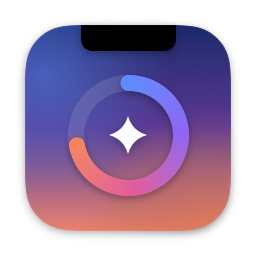
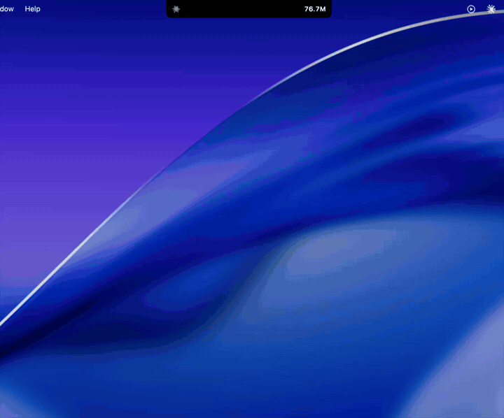
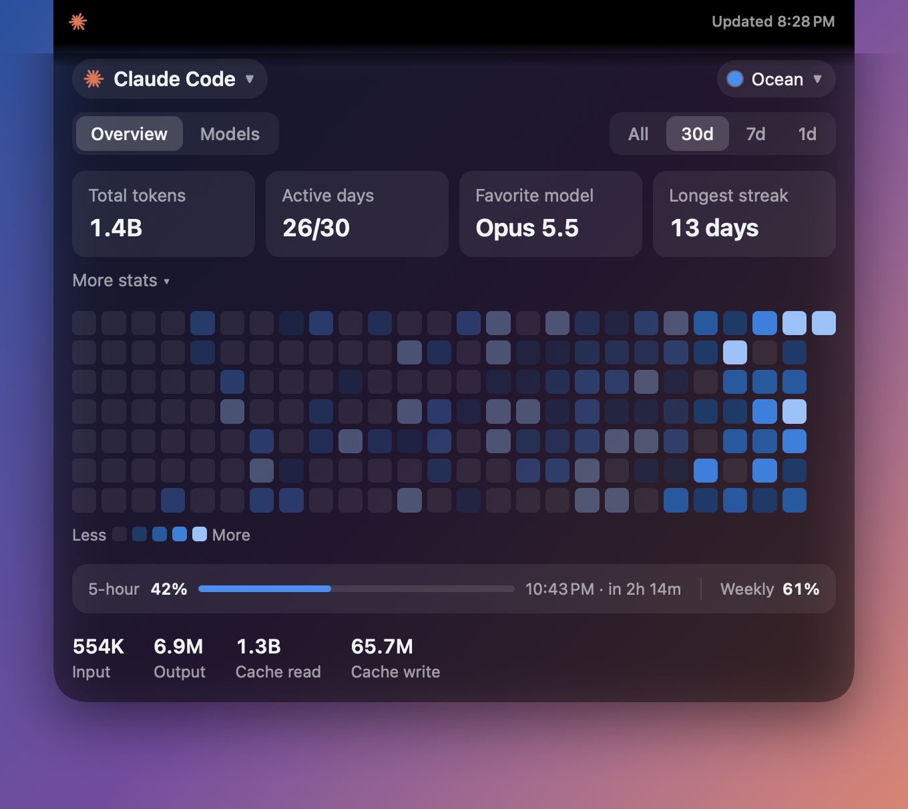
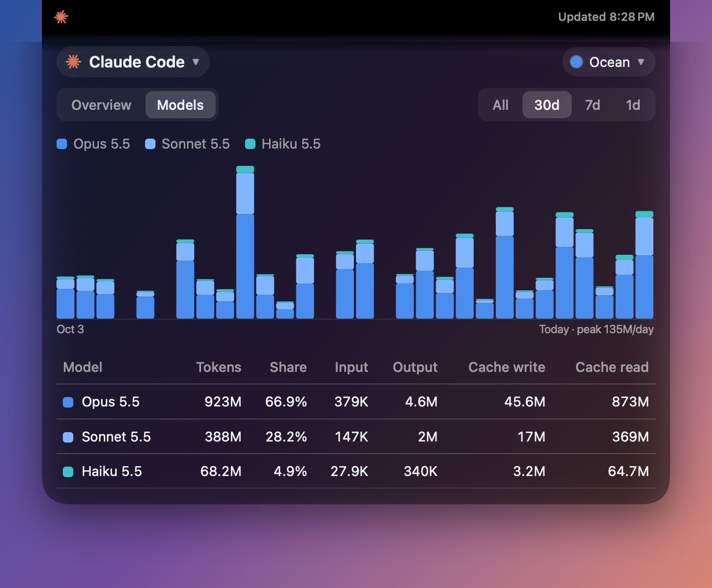
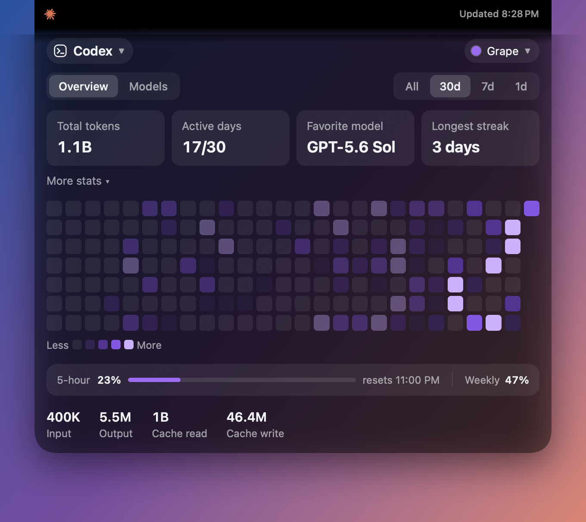
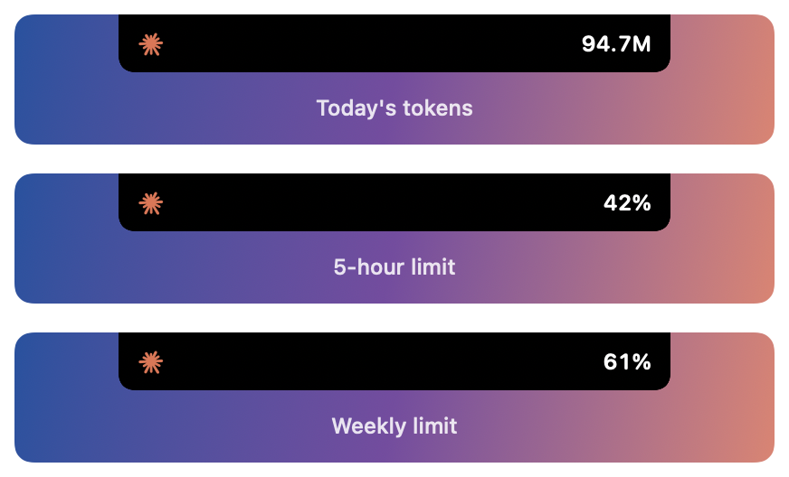

<p align="center"></p>

<h1 align="center">Token Notch</h1>

<p align="center">Your Claude Code and Codex usage, in your MacBook's notch.</p>

<p align="center"></p>

Closed, the notch shows the mark of the tool you used last and today's tokens, or how much of your 5-hour or weekly limit is gone. Click it and the full dashboard pours out of the notch: tokens, streaks, a contribution heatmap, a per-model breakdown and your plan's limits. Click anywhere else and it folds back in.

Unofficial; not affiliated with Anthropic or OpenAI.

**[Download Token Notch for Mac](https://github.com/maskedrepo/token-usage-widget/releases/latest/download/Token-Notch.zip)** · macOS 14 or later, Apple silicon and Intel. The glass look needs macOS 26.

## Install

1. Unzip it and move **Token Notch** to Applications.
2. Open it. The app isn't signed by Apple, so macOS blocks it the first time: open **System Settings → Privacy & Security**, scroll down and click **Open Anyway**. You only do this once.
3. For your Claude plan's limit percentages, sign in to the Claude Code command-line tool once: run `claude`, then `/login`, and choose your Claude subscription. Without it the app shows your current 5-hour window in tokens instead. Codex records its own limits, so it needs nothing.

The app opens at login by default. On a Mac without a notch it sits at the top of the screen and in the menu bar.

## What it shows

<p align="center">
  
  
</p>

- **Overview**: total tokens, active days, favorite model and longest streak, with more stats a click away (sessions, messages, peak hour, current streak, longest session, most active day). Then the heatmap, your limits and the input / output / cache split.
- **Models**: tokens per day stacked by model, and each model's share and token types.
- **All / 30d / 7d / 1d** ranges. Hover anything for exact values.
- **Limits** under the heatmap: the 5-hour limit with its reset time, and the weekly limit beside it. Orange from 80%, red from 95%.
- **Claude Code and Codex**: the pill at the top left switches between them, and the app follows whichever you used last. If you only use one, the other says so.
- **Four themes**: Ocean, Forest, Grape and Graphite.

<p align="center">
  
  
</p>

*Screenshots use made-up data.*

## Settings

Right-click the notch, or open the theme menu in the dashboard:

- **Notch shows**: today's tokens, the 5-hour limit or the weekly limit.
- **Animate icon**: the mark in the notch moves gently, or stays still. It also stays still with Reduce Motion.
- **Open at login**, **Refresh now** and **Quit** are in the right-click menu.

## Where the numbers come from

Everything is read on your Mac and nothing is uploaded. The one exception is Claude's limit percentages: the app asks Anthropic for them with Claude Code's own sign-in, as `/usage` does, and never stores the sign-in or sends it anywhere else.

- **Claude Code**: the transcripts in `~/.claude/projects/`, counting each API response once, plus `~/.claude/stats-cache.json` (the file behind `claude /stats`) for days whose transcripts Claude Code has since cleaned up. Older days only kept per-model totals, so their input / output / cache split is estimated from each model's overall mix and marked with ≈.
- **Codex**: the session logs in `~/.codex` (or `CODEX_HOME`), and its threads database for archived sessions, whose logs Codex compresses. Archived threads count on their last day of activity, with an estimated split. Codex's limits are the ones it logged with your last message.

Numbers refresh every minute, and only new lines are read, so it stays light. Totals land within a few percent of `claude /stats`.

## Build it yourself

Needs Xcode 26.

```bash
git clone https://github.com/maskedrepo/token-usage-widget.git
cd token-usage-widget/mac
./build-app.sh && open "build/Token Notch.app"
```

The app is Swift and SwiftUI. The open notch's dashboard is one web page, [mac/dashboard.html](mac/dashboard.html), which the app fills with your numbers.

## Tests

```bash
cd mac && swift test
```

The tests read made-up Claude Code and Codex folders in a temporary directory and never touch your own, and run the dashboard's own script against made-up numbers.

To redraw the screenshots from made-up data, from the repository's root:

```bash
(cd mac && swift build) && mac/.build/debug/TokenNotch --demo-shot docs
```

## License

MIT
